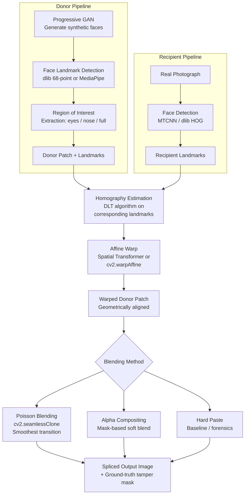

# GAN Face Splicing

<div align="center">

[](https://www.python.org/)
[](https://tensorflow.org/)
[](LICENSE)
[](https://github.com/ashish-code/GAN_face_splice/stargazers)
[]()

**Composites GAN-generated face patches into real images using homographic alignment, geometric warping, and seamless blending — donor/recipient framework for forensics research and data augmentation.**

</div>

---

## 🎭 Overview

As GAN-generated synthetic faces become indistinguishable from real ones, **detecting and understanding face splicing** — the insertion of a synthetic or borrowed face region into a target image — becomes critical for media forensics, deepfake detection, and adversarial robustness research.

This project implements a controllable **face splicing pipeline**:

- **Donor image**: A GAN-generated face (Progressive GAN by default) from which a face patch (eyes, nose, mouth, or full face region) is extracted
- **Recipient image**: A real photograph into which the donor patch is composited
- **Compositing**: Homographic alignment → affine warp → Poisson/alpha blending for photorealistic integration

The pipeline generates synthetic spliced images with ground-truth tamper masks, enabling the construction of training datasets for face forgery detection models.

---

## 🔄 Splicing Pipeline



---

## 📊 Use Cases

| Application | Description |
|-------------|-------------|
| **Forensics dataset generation** | Create labeled spliced face datasets for training deepfake detection models |
| **Data augmentation** | Augment face recognition training sets with controlled identity mixing |
| **Adversarial robustness testing** | Probe face verification systems with near-photorealistic spliced faces |
| **Steganography research** | Study how well traces of GAN generation survive compositing operations |

---

## 🚀 Installation

```bash
git clone https://github.com/ashish-code/GAN_face_splice.git
cd GAN_face_splice
pip install -r requirements.txt
```

**Requirements:**
```
tensorflow>=1.14
numpy>=1.18
opencv-contrib-python>=4.0
dlib>=19.21          # face landmark detection
scipy>=1.4
pillow>=7.0
```

**Install dlib with face landmark model:**
```bash
# Download shape predictor
wget http://dlib.net/files/shape_predictor_68_face_landmarks.dat.bz2
bunzip2 shape_predictor_68_face_landmarks.dat.bz2
```

---

## 💻 Usage

### Generate a Single Spliced Image

```python
import cv2
import numpy as np
from face_splice.gan_generator import ProgressiveGANWrapper
from face_splice.landmark_detector import FaceLandmarkDetector
from face_splice.homography import estimate_face_homography
from face_splice.blending import poisson_blend_face_patch

# Initialize components
gan = ProgressiveGANWrapper(checkpoint_dir="checkpoints/progressive_gan/")
detector = FaceLandmarkDetector(model_path="shape_predictor_68_face_landmarks.dat")

# Step 1: Generate donor face with GAN
donor_face = gan.generate(seed=42)           # np.ndarray (H, W, 3)
donor_lm  = detector.detect_landmarks(donor_face)  # 68 × 2 landmark array

# Step 2: Load recipient image
recipient = cv2.imread("recipient_photo.jpg")
recipient_lm = detector.detect_landmarks(recipient)
if recipient_lm is None:
    raise ValueError("No face detected in recipient image")

# Step 3: Estimate homography from donor → recipient coordinate system
H_matrix = estimate_face_homography(
    src_landmarks=donor_lm,
    dst_landmarks=recipient_lm,
    region="full_face"       # 'full_face' | 'eyes' | 'nose_mouth'
)

# Step 4: Warp donor patch to recipient geometry
warped_patch, warp_mask = cv2.warpPerspective(
    donor_face, H_matrix,
    dsize=(recipient.shape[1], recipient.shape[0]),
    flags=cv2.INTER_LINEAR,
    borderMode=cv2.BORDER_CONSTANT
), ...

# Step 5: Seamless Poisson blending
center = tuple(np.array(recipient.shape[:2][::-1]) // 2)
spliced_image = poisson_blend_face_patch(
    recipient=recipient,
    donor_patch=warped_patch,
    mask=warp_mask,
    center=center
)

# Step 6: Save output and ground-truth tamper mask
cv2.imwrite("output/spliced_image.jpg", spliced_image)
cv2.imwrite("output/tamper_mask.png", (warp_mask * 255).astype(np.uint8))
print("Spliced image saved.")
```

### Batch Dataset Generation

```python
from face_splice.dataset_generator import SplicedFaceDatasetGenerator

generator = SplicedFaceDatasetGenerator(
    real_faces_dir="data/real_faces/",       # CelebA, FFHQ, etc.
    gan_checkpoint="checkpoints/progressive_gan/",
    output_dir="data/spliced_dataset/",
    blending_methods=["poisson", "alpha", "hard"],  # all 3 for ablation
    splice_regions=["full_face", "eyes", "nose_mouth"],
    n_samples_per_config=1000
)

generator.run()
# Output: data/spliced_dataset/{real/, spliced/, masks/}
```

---

## 🧪 Forensics Evaluation

The generated datasets can be used to train and evaluate face forgery detectors. Example using a simple CNN:

```python
from face_splice.evaluate import ForensicsEvaluator

evaluator = ForensicsEvaluator(
    model_path="checkpoints/forgery_detector.pth",
    test_dir="data/spliced_dataset/test/"
)

metrics = evaluator.run()
print(f"AUC: {metrics['auc']:.3f}")
print(f"F1:  {metrics['f1']:.3f}")
print(f"EER: {metrics['eer']:.3f}")
# Breakdown by splicing region and blending method
evaluator.plot_roc_curves()
```

---

## 📁 Repository Structure

```
GAN_face_splice/
├── face_splice/
│   ├── gan_generator.py       # ProgressiveGAN wrapper
│   ├── landmark_detector.py   # dlib 68-point detector
│   ├── homography.py          # Landmark-based homography estimation
│   ├── blending.py            # Poisson, alpha, hard paste blending
│   └── dataset_generator.py  # Batch generation pipeline
├── notebooks/
│   └── splice_demo.ipynb      # Interactive demo
├── checkpoints/
│   └── progressive_gan/       # Pretrained PG-GAN weights
├── samples/
│   ├── real/                  # Sample real faces
│   └── spliced/               # Example spliced outputs
├── requirements.txt
└── README.md
```

---

## ⚠️ Ethics Statement

This project is intended **strictly for academic research** in face forensics, deepfake detection, and adversarial robustness. Generated synthetic images and spliced composites should not be used to deceive, harass, or impersonate individuals. The donor faces generated by Progressive GAN are fully synthetic and not based on any real person's identity.

---

## 📚 References

1. Karras, T. et al. (2018). *Progressive Growing of GANs for Improved Quality, Stability, and Variation*. ICLR (Progressive GAN).
2. Rossler, A. et al. (2019). *FaceForensics++: Learning to Detect Manipulated Facial Images*. ICCV.
3. Pérez, P. et al. (2003). *Poisson Image Editing*. SIGGRAPH (Seamless Cloning).

---

## 📄 License

MIT License — see [LICENSE](LICENSE) for details.

---

<div align="center">
  <sub>Built by <a href="https://github.com/ashish-code">Ashish Gupta</a> · Senior Data Scientist, BrightAI</sub>
</div>
